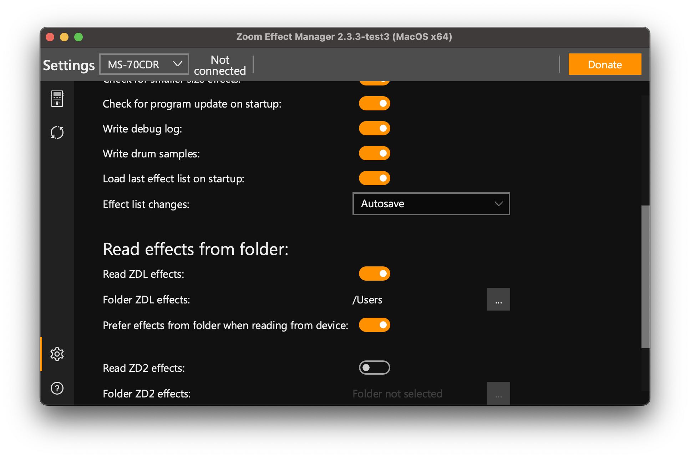
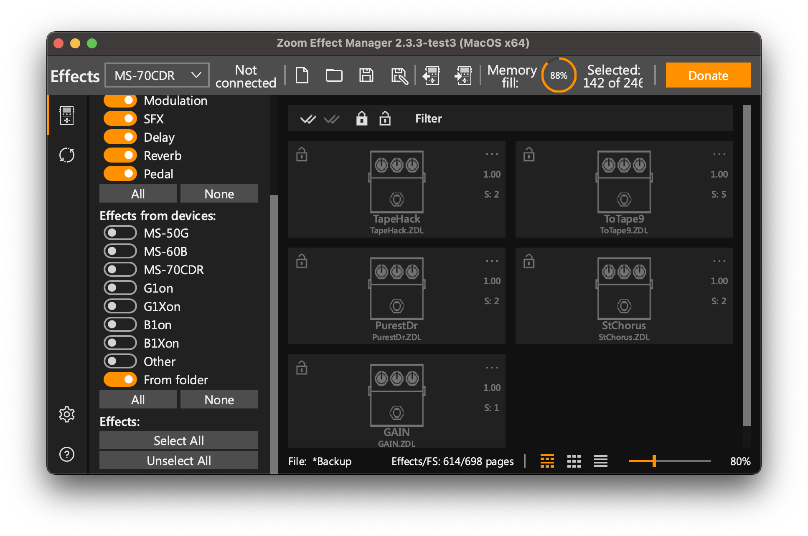

# Installing ZDLs With Zoom Effect Manager

The release `.ZDL` files are in [../dist/](../dist/). Use
[Zoom Effect Manager](https://zoomeffectmanager.com/en/download/) 2.3.3 or
newer and point it at that folder.

## Steps

1. Connect the pedal first, then open Zoom Effect Manager.
2. Open `Settings`.
3. Choose `Read Effects from folder`.
4. Select this repo's `dist/` folder.

5. In the effect source/filter area, enable `Effects from devices`.
6. Enable `From Folder`.
7. Add the desired custom effects and write them to the pedal.

## Never install two effects with the same ID

Every ZDL carries an effect ID: a group (`gid`) and a number (`fxid`). Zoom
Effect Manager shows them together as `0xGG00FFFF`. Two effects with the
same ID, even from different collections, are one effect to the pedal.

- If Zoom Effect Manager reports `repeating index effect - 0x...`, stop.
  Remove one of the two files from the folder (and from the pedal), then
  read the folder again. Do not swap one for the other in a single write.
- `TEcho4.ZDL` from before 2026-10-29 used `0x08000199` (Delay, 409), the
  same ID as `Spool.ZDL` from
  [themanro/ZoomMultistompZDL](https://github.com/themanro/ZoomMultistompZDL).
  Swapping them in one write left an MS-70CDR stuck at the boot logo, and
  it stopped responding after firmware updater attempts
  ([issue #8](https://github.com/repeat98/ZoomMultistompZDL/issues/8)). The
  current `TEcho4.ZDL` uses `0x080003B2` (946).
- If your pedal has or had `Spool.ZDL` and the old `TEcho4.ZDL`, remove the
  old `TEcho4.ZDL` from the pedal and write first. Then read the folder
  again and add the new `TEcho4.ZDL`.
- Patches saved with the old `TEcho4.ZDL` refer to its old ID. Pick
  TapeEcho4 again in those patches.
- A pedal that stops booting after a write may need more than the official
  firmware updater: recovery can mean reflashing its ROM chip with a
  programmer such as a CH341A. Back up your effect list before every write.

The IDs this repo and other collections use are listed in
[FXID-REGISTRY.md](FXID-REGISTRY.md).

## Notes

Back up your current effect list before writing. Current release effects target
ZDL-based MultiStomp pedals and are only hardware-tested on MS-70CDR firmware
2.10 so far.

If an effect does not appear, confirm that Zoom Effect Manager is reading the
same `dist/` folder shown in this repo and that the `From Folder` source is
enabled.

On MS-70CDR firmware 2.10, a Drive-category custom effect can flash correctly
but stay hidden in the pedal's on-device FX browser if no stock Drive effect is
installed. If `ToTape9.ZDL` writes successfully but does not appear while
scrolling effects, also install at least one stock Drive effect. With a stock
Drive effect present, the custom Drive effect has been reported visible.
